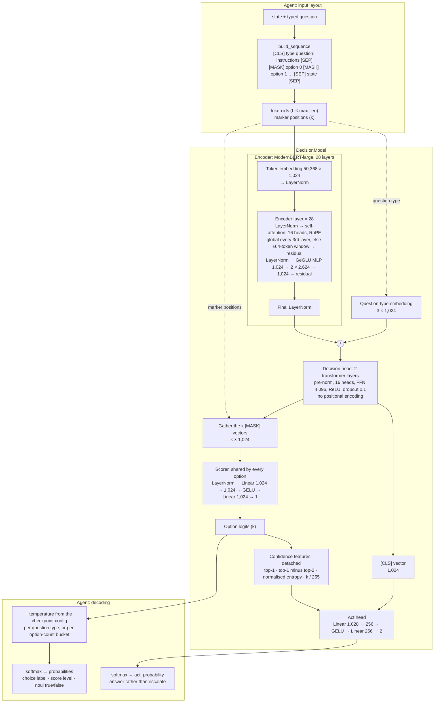
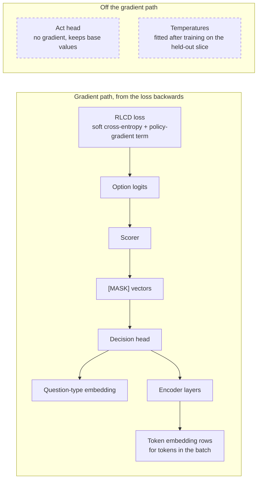

# Model architecture

Laya answers typed questions (`choice`, `score`, `noul`) about a state in one forward pass of
a bidirectional transformer. It does not generate text. Every option is written into the input
behind its own `[MASK]` marker, the network turns each marker into one number, and the
comparison of those numbers is the answer.

This page describes that network layer by layer, and which parts of it the
[fine-tuning notebook](https://github.com/NandhaKishorM/laya/blob/main/notebooks/laya_finetune_typed_decisions_2xT4_kaggle.ipynb)
updates. The source of truth is `laya/common.py`: `build_head` and `build_sequence` lay out
the input, `DecisionModel` is the network, and `build_model` assembles it from a checkpoint
config. Shapes and parameter counts below were read from the published checkpoints. Where one
number is given, it is for `laya` (ModernBERT-large).

## Overview



The model has two outputs. The option logits carry the answer. The act head estimates whether
to answer at all or escalate. Laya's own decision layers (type embedding, head, scorer, act
head) add about 26.5M parameters to the 395M-parameter encoder.

## Checkpoints

All three published checkpoints use this architecture. They differ in the encoder, the
dimension `d` that follows from it, and the length budgets in `rl_agent_config.json`.

| Checkpoint | Encoder | `d` | Encoder layers | Heads | MLP width | Vocabulary | Parameters | `max_len` / `head_max_len` |
|---|---|---|---|---|---|---|---|---|
| `laya` | ModernBERT-large | 1,024 | 28 | 16 | 2,624 | 50,368 | 421.3M | 512 / 192 |
| `laya-multilingual` | mmBERT-base | 768 | 22 | 12 | 1,152 | 256,000 | 321.9M | 1,024 / 256 |
| `laya-typed-decisions` | ModernBERT-large | 1,024 | 28 | 16 | 2,624 | 50,368 | 421.3M | 1,024 / 256 |

`laya-typed-decisions` is `laya` after the notebook's fine-tune. Its weights and length
budgets changed, and its layers did not. Both encoders are ModernBERT-family models, so the
layer description below applies to both. In the decision head, `d` sets the width, `d / 64`
the number of attention heads and `4d` the feed-forward width.

## Input layout

`build_head` writes the question half of the sequence and `build_sequence` appends the state:

```
[CLS] choice question: <instructions> [SEP] [MASK] opt0 [MASK] opt1 … [MASK] optk-1 [SEP] <state> [SEP]
```

- Each option is rendered as text (`render_options`): `label: description` for `choice`,
  `level i: description` for `score`, and `false: …` / `true: …` for `noul`. Each is capped at
  48 tokens and preceded by a `[MASK]`. The position of that `[MASK]` is the option's marker.
- The question half is limited to `head_max_len` tokens. The options are placed first, and
  the instructions get the room left over (at least 8 tokens). If the options would leave less
  than 16 tokens, every option is first cut to the same shorter length.
- The state is serialised to text (JSON for dicts and lists), with any literal `[MASK]` in it
  blanked. It fills whatever room `max_len` leaves after the head and is cut off beyond that.
- The model gets the token ids, an attention mask, the marker positions with a mask for rows
  that have fewer options, and the question-type index (`choice` 0, `score` 1, `noul` 2).

The number of options is not fixed anywhere in the network. A question with *k* options has
*k* markers and produces *k* logits.

`option_layout = "parallel"` is an alternative layout (`parallel_layout`) in which options
share position ids and cannot attend to each other. Every published checkpoint uses the
default sequential layout shown here.

## Layers

### Token embedding

A lookup table of 50,368 × 1,024 (51.6M parameters), followed by a LayerNorm. It holds no
positional information: position enters inside attention, through rotary embeddings (RoPE).
So at this stage every `[MASK]` in the sequence has the same vector. Whatever later tells the
options apart has to come from attention.

### Encoder layers (× 28)

Each layer is pre-norm and adds its output to the residual stream:

1. LayerNorm, then multi-head self-attention. A single `Wqkv` (1,024 → 3,072) produces
   queries, keys and values for 16 heads of 64 dimensions. RoPE is applied to queries and keys.
   `Wo` (1,024 → 1,024) maps the result back. Every third layer (0, 3, 6, … 27) attends
   globally (RoPE base 160,000). The others attend to a sliding window of ±64 tokens (RoPE
   base 10,000). The first layer skips this LayerNorm, because the embedding is already
   normalised.
2. LayerNorm, then a gated MLP (GeGLU). `Wi` (1,024 → 5,248) is split into an input half and
   a gate half of 2,624 each. The result is `Wo(GELU(input) × gate)`, mapping 2,624 → 1,024.

That comes to about 4.2M attention and 8.1M MLP weights per layer, 343.2M across all 28. A
final LayerNorm closes the encoder.

ModernBERT has no bias terms: its attention, MLP and LayerNorm biases are all disabled. The
only biases in Laya are in the layers below.

### Question-type embedding

A 3 × 1,024 table, one row per question type. The row for the question's type is added to
every position's vector. It is what lets a single network answer the three question types
differently.

### Decision head (2 layers)

Two `torch.nn.TransformerEncoderLayer`s: pre-norm, 16 heads, feed-forward 1,024 → 4,096 →
1,024 with ReLU, dropout 0.1, with biases (12.6M parameters each, 25.2M together). They are
Laya's own layers, not part of the pre-trained encoder. Their job is to let the option markers
compare against each other, the question and the state before scoring. They have no positional
encoding of their own. Anything they know about order comes from the encoder's output.

### Scorer

The vectors at the *k* marker positions are gathered (`k × 1,024`). Each one goes through the
same small network: LayerNorm → Linear 1,024 → 1,024 → GELU → Linear 1,024 → 1 (1.05M
parameters). The scorer does not know which option it is scoring. It applies one learned "this
looks like the answer" read-out to each marker vector. Positions past a row's own *k* are set
to −10⁴, so they get zero probability.

### Act head

Inputs: the head's `[CLS]` vector, plus four features computed from the option probabilities
with gradients stopped: top-1 probability, the gap between top-1 and top-2, entropy normalised
by log *k*, and *k* / 255. A Linear 1,028 → 256 → GELU → Linear 256 → 2 (0.26M parameters)
produces two logits, one per action: answer, or escalate (`act_costs` in the config). The
Agent reports the softmax of the first logit as `act_probability`.

### Temperature and decoding

Calibration is applied in the Agent, not in the network. The option logits are divided by a
temperature from the checkpoint config, then softmaxed. The temperature is taken from
`temperature_by_options` for the question's bucket (for example `choice:3-5`) when the config
has one, and otherwise from `temperature`, one value per question type. Values are clamped to
`[0.5, 5.0]` at load. Temperature changes how confident the answer is, never which option comes
first. `DecisionModel` also carries a `temperature` buffer that is saved with the weights, but
inference reads only the config values.

## Parameter budget (`laya`)

| Component | Parameters | Share |
|---|---|---|
| Token embedding and its LayerNorm | 51,577,856 | 12.2% |
| 28 encoder layers | 343,202,816 | 81.5% |
| Encoder final LayerNorm | 1,024 | <0.1% |
| Question-type embedding | 3,072 | <0.1% |
| Decision head, 2 layers | 25,192,448 | 6.0% |
| Scorer | 1,052,673 | 0.2% |
| Act head | 263,938 | 0.1% |
| Total | 421,293,827 | |

## Inspecting the architecture yourself

`scripts/visualise_model.py` loads a checkpoint on CPU and shows its layers in one of two
local viewers. Neither viewer is a dependency of the package, so install the one you use:

```bash
pip install ai-edge-model-explorer   # interactive graph
pip install torchinfo                # layer table

python scripts/visualise_model.py                     # Model Explorer on http://127.0.0.1:8080
python scripts/visualise_model.py --summary           # torchinfo table, printed to the terminal
python scripts/visualise_model.py --summary --depth 3 # also list every encoder and head layer
python scripts/visualise_model.py --model convaiinnovations/laya-multilingual --port 8081
```

- With no flags, the model is exported with `torch.export` and served in Google's
  [Model Explorer](https://github.com/google-ai-edge/model-explorer). About 1,900 operations are
  grouped into 95 collapsible layers, named after the modules on this page. Expand
  `laya.common.DecisionModel` to see the encoder, the type-embedding add, the two head layers,
  the marker gather, the scorer and the act head's inputs in order. Expand any layer to see its
  operations. The server runs until you press Ctrl+C.
- `--summary` prints each module's output shape and parameter count, the numbers in the
  [parameter budget](#parameter-budget-laya) above. `--depth` sets how many module levels the
  table expands (default 2).

The graph is traced from a single example input: a choice question with three options, 26
tokens on `laya`. Shapes in the viewer are that example's, but the layers are the same for any
input. The first run downloads the checkpoint, about 0.85 GB for `laya`.

TensorBoard's graph view (`SummaryWriter.add_graph`) also works on this model. It shows about
2,200 low-level operations with little grouping, and it relies on `torch.jit.trace`, which
PyTorch has deprecated, so the script does not use it.

## Training

This section covers what the notebook's training script (`train_ddp.py`, built on `laya.train`)
does to each component. The recipe itself is in
[Fine-tuning Laya on your own decisions](../finetune.md#the-training-recipe).

### What is updated

The notebook loads the full `laya` checkpoint and trains every parameter that the loss reaches.
AdamW uses two parameter groups:

| Component | Updated by the optimiser | Learning rate | Notes |
|---|---|---|---|
| Token embedding | Yes, rows for tokens in the batch | 2.5e-5 (encoder group) | Rows for tokens absent from the data get a zero gradient. Weight decay shrinks them by less than 0.01% over the run. |
| Encoder layers and final norm | Yes | 2.5e-5 | Gradient checkpointing only saves memory. It does not change what is learned. |
| Question-type embedding | Yes | 1e-4 (head group) | All three rows are used: typed-decisions has `choice`, `score` and `noul` questions. |
| Decision head | Yes | 1e-4 | The only layers with active dropout (0.1) during training. |
| Scorer | Yes | 1e-4 | |
| Act head | No | (1e-4, unused) | The loss reads only the option logits, so the act head never gets a gradient. DDP runs with `find_unused_parameters=True` for this reason, and AdamW skips parameters with no gradient. It keeps the base checkpoint's values. |
| Temperatures | Not by gradient | n/a | Fitted after training, on a held-out slice. See below. |
| Tokenizer, RoPE | No | n/a | The vocabulary is fixed, and RoPE has no parameters. |

Both learning rates follow a cosine schedule down to 1e-6. At the notebook's settings that is
about 350 optimiser updates: 5,600 training items, an effective batch of 64, 4 epochs.

### How the gradient reaches each layer



Both halves of the loss are functions of the option logits alone:

- Soft cross-entropy compares the softmax of the logits with the gold distribution over each
  question's options.
- The policy-gradient term adds Gaussian noise to a detached copy of the logits, four samples
  per item. Each noisy distribution is scored with proper scoring rules (log, spherical, and
  ranked probability for `score` questions). The logits are then pulled towards the samples
  that scored above the group's mean. The noise scale falls from 0.4 to 0.1 over the epochs.

Every layer on the path from the logits back to the embedding therefore gets a gradient. The
act head is off that path. Its input features are computed from detached probabilities, and its
own logits feed no loss, so it ends the run as it started. The question-type embedding is added
before the head, so it gets its gradient through the head.

### Calibration after training

The script holds out up to 400 items (10% of the data, at a fixed seed) before sharding the
rest across the two GPUs, so no training batch ever contains them. After the last epoch, rank
0 runs the trained model on those items in eval mode, without gradients. It then fits
temperatures with `laya.calibrate.fit_temperature_map`: one per question type with at least 10
items. A bucket temperature needs at least 2,000 items in its bucket, which a 400-item slice
never reaches. The fitted values replace the config's `temperature`, and the inherited
`temperature_by_options` are removed so they cannot override the new fit. The weights are not
touched in this step. The details are in
[Calibration is part of the run](../finetune.md#calibration-is-part-of-the-run).

### What the fine-tuned checkpoint carries

`save_checkpoint` writes the trained weights (stored in fp16), the encoder config, the
tokenizer, and an `rl_agent_config.json` that records the training budgets (`max_len` 1,024,
`head_max_len` 256), `fine_tuned: true` and the fitted temperatures. The architecture is
unchanged, so `laya.load` opens the result the same way as the base checkpoint.
