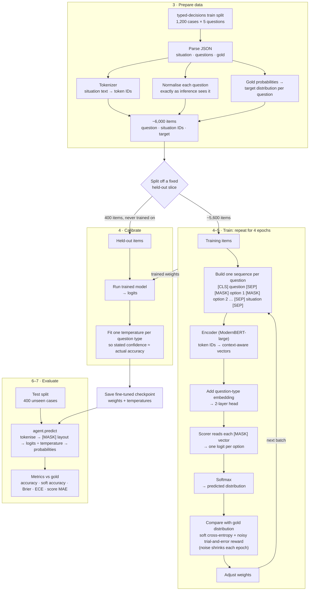

# Training

This explains training as it's implemented in `notebooks/laya_finetune_typed_decisions_2xT4_kaggle.ipynb`. 

The notebook takes a model that already makes typed decisions (`convaiinnovations/laya`) and adjusts it on 1,200 labelled cases, so that its answers on that kind of case get closer to the reference answers. Every step below is one link in a chain: text goes in, numbers come out, the numbers are compared with the right answer, and the model is adjusted.

## What the model does

You give it a situation, such as a support ticket or an order record, and a question about it. It returns a probability for each possible answer. There are three question types:

| Type | Question | Output |
|---|---|---|
| `choice` | "Which category is this?" with labelled options | One probability per label |
| `noul` | A yes/no statement | P(false), P(true) |
| `score` | "Rate on this rubric" with ordered levels | One probability per level |

Each dataset case has one situation and five questions. The reference answer for each question is itself a distribution, for example 70% A, 20% B, 10% C, not just "A". So the model learns to match how sure a careful judge would be, not only which answer is right. The comparison table's "Teacher Self-Agreement" row suggests these soft labels come from a stronger teacher model judging the same case several times.

## What a tokenizer is and why it's needed

A neural network only does arithmetic on numbers; it can't read text. A tokenizer is the fixed lookup step that turns text into a sequence of integers the network can work with.

1. It splits text into tokens: common words stay whole and rare words break into reusable pieces.
2. It maps each token to its ID in a fixed vocabulary. Laya's has 50,368 entries.

Here is Laya's own tokenizer on three inputs (I ran these):

| Text | Tokens | IDs |
|---|---|---|
| `Customer says the refund never arrived.` | `Customer`, `Ġsays`, `Ġthe`, `Ġrefund`, `Ġnever`, `Ġarrived`, `.` | 30298, 2296, 253, 23005, 1620, 7244, 15 |
| `The chargeback is unreimbursable.` | `The`, `Ġcharge`, `back`, `Ġis`, `Ġun`, `re`, `imb`, `urs`, `able`, `.` | 510, 4179, 2135, … |
| `{"order_id": 8812}` | `{"`, `order`, `_`, `id`, `":`, `Ġ88`, `12`, `}` | 9819, 2621, 64, … |

(`Ġ` marks a preceding space.) Splitting into pieces means the vocabulary stays finite but no word is ever unknown: "unreimbursable" is built from parts the model has seen many times.

Inside the model, each ID selects one row of an embedding table, a learned vector that is the model's starting representation of that token. That's why the tokenizer must be exactly the one the model was pre-trained with. ID 23005 means "refund" only because the embedding table was trained that way. A different tokenizer would give the same ID to some other piece of text, and the model would be reading nonsense. So the notebook downloads the tokenizer from the same snapshot as the weights.

The tokenizer also provides special tokens that act as structural markers rather than words: `[CLS]` (50281) opens a sequence, `[SEP]` (50282) separates parts, and `[MASK]` (50284) plays a central role here, explained below.

## The notebook, section by section

### 1–2. Setup

These check the GPUs and install packages; there's no modelling logic here.

### 3. Turning cases into training items

For each case:

- The situation is converted to text (JSON if it's structured) and tokenised once, since all five questions share it.
- Each question becomes one training item: the question, the situation's token IDs and the target distribution.

This gives about 6,000 items from 1,200 cases. Questions that can't be represented faithfully are dropped, for example when two options would come out as identical tokens.

### 4. How a question becomes one model input

Every question is laid out as a single token sequence:

```
[CLS] noul question: Is the customer eligible for a refund? [SEP]
[MASK] false: no, the statement does not hold [MASK] true: yes, the statement holds [SEP]
{"order_id": 8812, ...situation... } [SEP]
```

The key idea is that each option is preceded by its own `[MASK]` token. The model works out a vector for every position in light of every other position, so each `[MASK]` vector ends up summarising "this option, given this question and this situation". The model then reads one score from each `[MASK]` and compares the scores. That's how one model handles 2, 4 or 10 options without being rebuilt: the number of answers is just the number of `[MASK]` tokens.

There are length limits. The question part gets at most 192–256 tokens and the whole sequence 512–1024, so a long situation is cut short. Section 3 tokenises the situation with the base checkpoint's 512-token budget, while the training script in section 4 allows 1,024, so a situation longer than 512 tokens is still cut at 512 during training.

### 4 (continued). What the model computes

The model is `DecisionModel` in `laya/common.py:575`:

1. An encoder, ModernBERT-large (about 395M of the 421M parameters), turns every token ID into a context-aware vector. This is where the language understanding lives, and it is what pre-training produced.
2. A question-type embedding is added to every vector, so the model knows whether it's answering a choice, score or yes/no question.
3. A small head of two more transformer layers refines the vectors.
4. A scorer takes the vector at each `[MASK]` and produces one number per option, called a logit.
5. Softmax turns the logits into probabilities that sum to 1.

### 4 (continued). How the model learns

For each item, the predicted distribution is compared with the gold distribution and the weights are nudged to reduce the gap. Two signals are combined (`rlcd_loss`, `laya/train.py:499`):

- Soft cross-entropy is the main signal. It is small when the model puts high probability where the gold puts high probability. With a soft target such as 70/20/10, it pulls the prediction towards 70/20/10 rather than towards 100/0/0.
- A trial-and-error term adds random noise to the model's answer several times. Each noisy version is scored with a proper scoring rule, a measure that rewards honest probabilities, not just a correct top pick. For `score` questions it also rewards being close in level, so being one level off is penalised less than being three off. The model is then pushed towards the variations that scored better. The noise starts larger and shrinks over the four passes through the data, moving from exploration to refinement.

This repeats over all items four times (four epochs). Splitting the work across two GPUs and the learning-rate settings only make it faster or more stable; they don't change what is learned.

### 4 (continued). Held-out slice and calibration

Before training, 400 items are set aside and never trained on. After training, the model's scores are run on them to answer: when the model says 90%, is it right about 90% of the time? Usually it isn't; models tend to be overconfident.

The fix is a temperature: one number per question type that the logits are divided by before softmax. A temperature above 1 softens overconfident answers and one below 1 sharpens timid ones. It doesn't change which answer ranks first, only how confident the model claims to be. It's fitted on held-out data because fitting it on data the model has memorised would make the model look better calibrated than it is.

### 5. Running training

`torchrun` runs the script from section 4 and saves the fine-tuned model, with its temperatures, to `/kaggle/working/laya_finetuned_typed_decisions`.

### 6. Prediction on unseen cases

The fine-tuned model answers the 400 test cases (2,000 questions), which it has never seen. `agent.predict` does the same tokenise → `[MASK]` layout → encoder → probabilities chain internally, then applies the temperatures.

### 7. Scoring

| Metric | What it tells you |
|---|---|
| Accuracy | Whether the top answer matched the gold label |
| Soft accuracy | The overlap between predicted and gold distributions |
| Brier, KL, total-variation distance | How far the whole predicted distribution is from the gold one (lower is better) |
| ECE | Whether stated confidence matches actual accuracy, which is what calibration targets |
| Score MAE, within-one-level | For rubric questions, how many levels off the prediction is |

These are compared with an API-based general model, a smaller specialist model, and the teacher's own agreement with itself (a practical ceiling).

### 8–9. Housekeeping

These optionally upload the model to Hugging Face and save the metrics as JSON.

## In one line

Text → tokenizer → token IDs → encoder (understanding) → one vector per `[MASK]` (one per option) → scores → probabilities. Training compares those probabilities with the gold distributions and adjusts the weights. Calibration then corrects how confident the probabilities claim to be, and evaluation checks all of it on unseen cases.

One detail you might notice in the code: the model also has a small "act" head that decides between answering and escalating. Training here never adjusts it (the loss uses only the option scores), so it keeps whatever it learned before fine-tuning.


